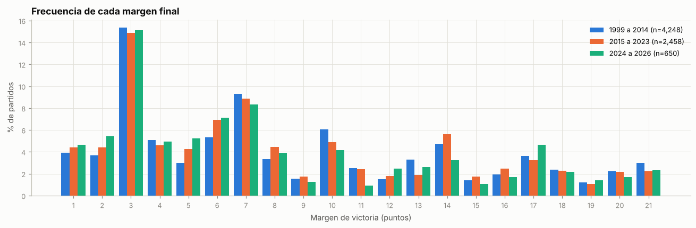
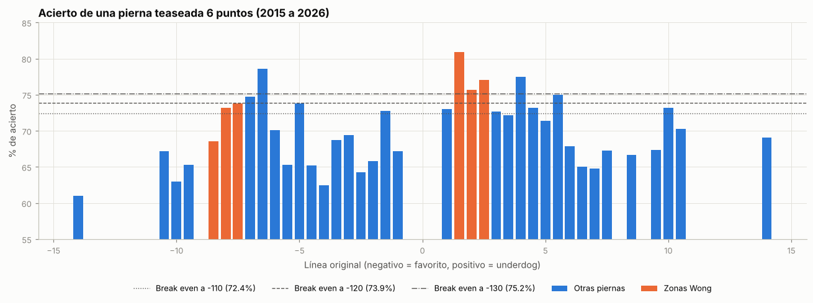
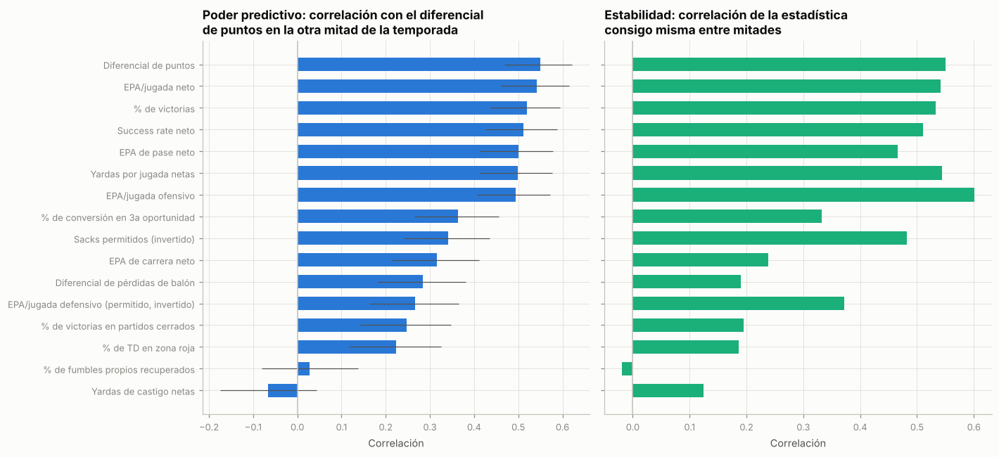
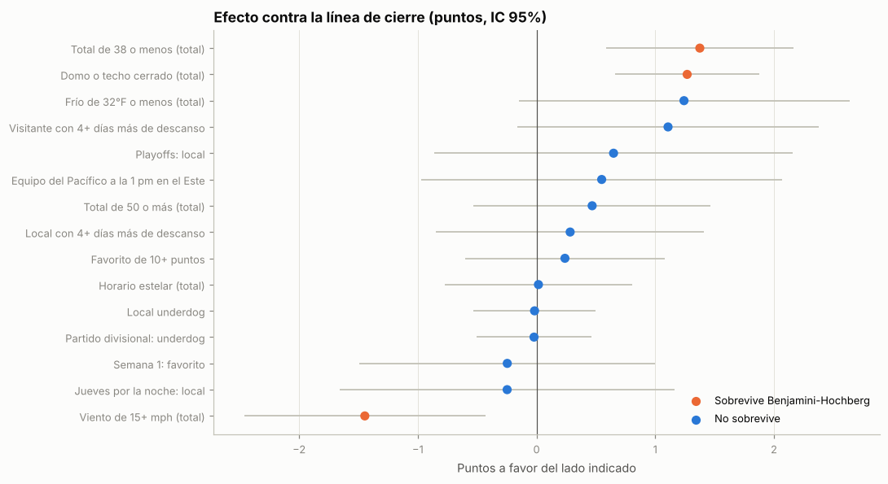
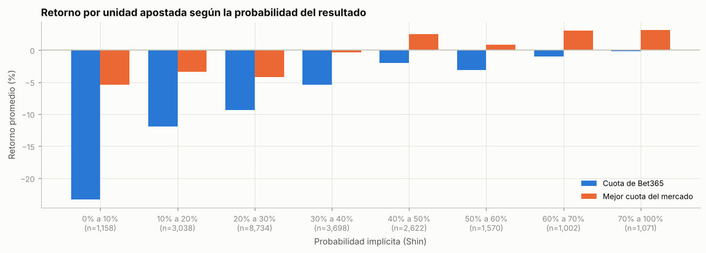
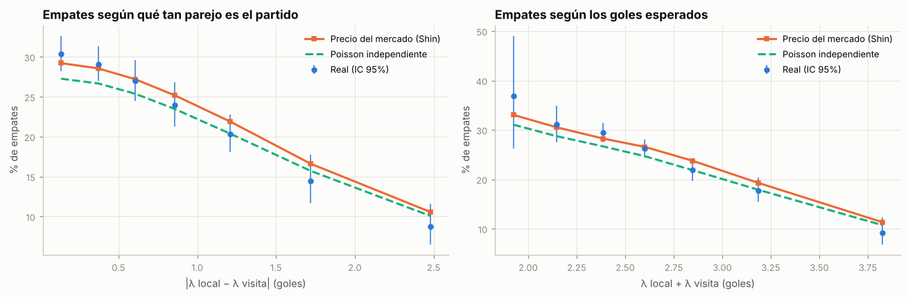
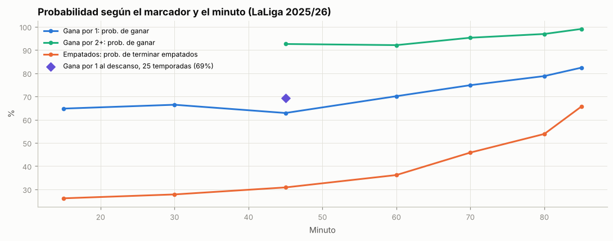

# Sports Analytics

[](https://www.python.org/downloads/)
[](LICENSE)
[](notebooks)

EDA de NFL y LaLiga hecho como lo haría el trader de una casa de apuestas. La pregunta no
es "¿quién gana?" sino tres preguntas previas a cualquier modelo:

1. **¿Qué tan bueno es el mercado?** La línea de cierre es el mejor modelo público que existe; todo se mide contra ella.
2. **¿Qué forma tienen los resultados?** Números clave, empates y goles por minuto definen cómo se precia cada mercado.
3. **¿Qué señales son reales?** Antes de elegir variables, separar lo que predice el futuro de lo que es suerte.

## Resultado principal: el mercado le gana al modelo

| Prueba fuera de muestra | Modelo | Mercado |
|---|---:|---:|
| LaLiga 2025/26, 380 partidos (log loss 1X2, menor es mejor) | Dixon-Coles: 0.973 | **Bet365 sin margen: 0.962** |
| LaLiga 2025/26, mezcla 20% modelo y 80% mercado | 0.963 | **0.962** |
| NFL 2022 a 2025, 895 partidos (error medio del margen, en puntos) | Spread + EPA + dif. de puntos: 9.455 | **Solo spread: 9.449** |

Ese resultado va en portada a propósito. Un modelo hecho solo con resultados y
estadísticas públicas *debería* perder contra un mercado que también sabe de
alineaciones, lesiones y dinero informado. El EDA explica dónde está esa brecha y dónde
el mercado sí tiene puntos débiles.

> Esto es un proyecto de investigación, no una recomendación de apuestas. Los mismos
> datos muestran que el mercado es muy difícil de vencer, y cualquier edge aparente puede
> desaparecer por margen de la casa, límites, movimiento de línea o simple ruido.

## Hallazgos

### NFL

**El 3 manda, pero el 7 pierde peso.** El 15% de los partidos termina con diferencia de 3 en
las tres eras. Desde el cambio del punto extra (2015) y el kickoff dinámico (2024), el 7 bajó
de 9.3% a 8.3% y el 6 subió de 5.3% a 7.1%. Por eso medio punto alrededor del 3 vale entre
20 y 30 centavos, mientras que en la mayoría de los otros números vale menos de los 10 que
se suelen cobrar.



**Los Wong teasers ya no alcanzan.** Las piernas que cruzan el 3 y el 7 ganaron 76.7% de
2015 a 2023 y 73.0% desde 2024, por debajo del break even a -120 (73.9%). Las de underdog
rinden más que las de favorito.



**Señal contra ruido.** Partiendo cada temporada en dos mitades, EPA por jugada (0.54) y
diferencial de puntos (0.55) son lo que mejor predice. El pase pesa mucho más que la
carrera, y la ofensiva es más estable que la defensa. Los fumbles recuperados, las
penalidades y el récord en partidos cerrados son mayormente suerte. Aun así, la línea de
cierre ya incorpora todo esto: agregarlo al spread no mejora el error fuera de muestra.



**Las tendencias de los tipsters son ruido.** De 15 factores situacionales, 3 sobreviven la
corrección de Benjamini-Hochberg y solo uno es consistente en las dos mitades de la historia:
con viento de 15 mph o más, el under ganó 57% de 684 partidos.



Otros resultados del notebook: la línea de cierre no tiene sesgo (pendiente 1.04) y su
error bajó de 10.6 a 9.7 puntos; la ventaja de local que cobra el mercado pasó de ~2.5 a
1.5 puntos; y el mercado ajusta el rating de un equipo 0.09 puntos por cada punto de
sorpresa, sin sobrerreaccionar.

### LaLiga

**El sesgo favorito-longshot es fuerte.** Apostar a resultados con menos de 10% de
probabilidad devuelve -23% por unidad en Bet365; a los de 70% o más, -0.2%. Quitar el
margen con Shin o power corrige buena parte del sesgo; el método multiplicativo deja hasta
4.5 puntos de error en los favoritos.



**El mercado aplana el empate.** Con los goles esperados implícitos en las cuotas, el
empate pasa 30.4% en partidos parejos (el mercado cobra 29.2%) y 8.7% en partidos dispares
(el mercado cobra 10.6%). La Poisson independiente se queda corta en los parejos. Es el
patrón más prometedor del EDA y todavía hay que validarlo con cuotas de cierre.



**En vivo mandan el minuto y la fuerza previa.** El 56% de los goles llega en el segundo
tiempo y el tiempo añadido final es el tramo más goleador. Un favorito claro que pierde
por 1 al descanso todavía gana 42% de las veces; uno leve, 13%.



Otros resultados del notebook: la ventaja de local cayó de 0.45 a 0.22 goles sin público y
hoy vale ~0.37; los puntos que un equipo saca de más o de menos frente al mercado no
persisten (correlación -0.06 entre mitades); y con 8 jornadas, la diferencia de goles
predice el resto de la temporada mejor que la tabla.

## Notebooks

| Notebook | Contenido |
|---|---|
| [`01_nfl_eda_sportsbook.ipynb`](notebooks/01_nfl_eda_sportsbook.ipynb) | 7,356 partidos de NFL (1999 a 2026) con líneas de cierre y play by play con EPA (2016 a 2025): sesgo del spread, spread a probabilidad, moneyline y sesgo favorito-longshot, números clave, precio del medio punto, teasers, totales, ratings implícitos del mercado, señal contra ruido y factores situacionales. |
| [`02_laliga_eda_sportsbook.ipynb`](notebooks/02_laliga_eda_sportsbook.ipynb) | 9,419 partidos de LaLiga (2000/01 a 2026/27): margen de la casa, métodos para quitar el margen, sesgo favorito-longshot, ventaja de local, goles esperados implícitos, Poisson contra marcadores reales, empates, probabilidades en vivo, señal contra ruido, suerte contra el mercado, ratings de fuerza y ritmo, y un predictor Dixon-Coles con capa de xG. |
| [`espn_api/`](notebooks/espn_api) | Exploración de la API no oficial de ESPN para NFL y fútbol: scoreboard, standings, rosters, box scores, gamelogs y odds. Se publican sin ejecutar porque requieren acceso a ESPN. |

Los dos notebooks de EDA están ejecutados: los gráficos y tablas se ven directo en GitHub.
Cada sección explica el concepto antes del código y cierra con lo que dice la data y qué
implica para el modelo.

## Investigación de respaldo

[`docs/research/respaldo_estadistico_apuestas.md`](docs/research/respaldo_estadistico_apuestas.md)
reúne la base matemática y estadística detrás de este EDA, con fórmulas y fuentes: modelos
de marcador (Poisson, Dixon-Coles, normal de Stern con números clave), eficiencia del mercado
y métodos para quitar el margen, Kelly fraccional, CLV y tamaño de muestra, y los costos de
ejecutar en Kalshi, Polymarket y sportsbooks. Las notas por tema están en
[`docs/research/notas/`](docs/research/notas). Cada dato marca si se verificó en la fuente primaria.

## Playbook de LINEMAKER SPORTS

[`docs/linemaker-playbook/`](docs/linemaker-playbook/index.md) resume los 414 videos del canal
de YouTube LINEMAKER SPORTS. Cada regla que da el canal se agrupó en 48 hipótesis que se pueden
probar contra el mercado, con lectura previa y plan de prueba, más temas, cómo cambió su método
de 2020 a 2026 y en qué se contradice. Cada referencia enlaza al video en YouTube. Las notas por
video y los transcripts se quedan en local y no se publican.

## Cómo funciona

* **El mercado como benchmark.** Cada análisis compara contra la línea o cuota de cierre, no contra el porcentaje de aciertos.
* **Probabilidades sin margen.** Las cuotas se convierten en probabilidades con los métodos multiplicativo, power y Shin, y se compara su calibración.
* **Goles esperados desde las cuotas.** Se busca el par de λ de Poisson que reproduce el 1X2 y el over/under de cada partido.
* **Ratings implícitos.** Mínimos cuadrados sobre los spreads (NFL) o sobre la supremacía y el total esperado (LaLiga).
* **Señal contra ruido.** Mitades intercaladas de cada temporada: estabilidad de cada estadística y correlación con el resultado en la otra mitad.
* **Pruebas múltiples.** Corrección de Benjamini-Hochberg y consistencia del signo entre eras antes de aceptar cualquier tendencia.
* **Validación honesta.** Walk forward: cada semana se ajusta el modelo solo con partidos anteriores.

## Estructura

```text
sports-analytics/
├── notebooks/
│   ├── 01_nfl_eda_sportsbook.ipynb
│   ├── 02_laliga_eda_sportsbook.ipynb
│   └── espn_api/
│       ├── espn_nfl_explorer.ipynb
│       └── espn_soccer_explorer.ipynb
├── predicciones/          # probabilidades previas a cada jornada, para medir calibración
├── docs/img/              # gráficos del README
├── docs/research/         # investigación de respaldo y notas por tema
├── docs/linemaker-playbook/  # hipótesis y síntesis del canal LINEMAKER SPORTS
├── pyproject.toml
├── requirements.txt
└── LICENSE
```

## Cómo correrlo

Con [uv](https://docs.astral.sh/uv/):

```bash
uv sync
uv run jupyter lab
```

O con pip:

```bash
pip install -r requirements.txt
jupyter lab
```

Los datos se descargan solos la primera vez y quedan en `data_nfl/` y `data_laliga/` junto
a cada notebook (unos 240 MB en total, ignorados por git). No se necesita ninguna API key.

## Datos

| Fuente | Qué aporta |
|---|---|
| [nflverse nfldata](https://github.com/nflverse/nfldata) | Partidos de NFL desde 1999 con spread, total y moneyline de cierre, clima y descanso. Incluye el ID de ESPN de cada partido. |
| [nflverse-data](https://github.com/nflverse/nflverse-data) | Play by play de NFL con EPA y success rate. |
| [Club Football Match Data](https://github.com/xgabora/Club-Football-Match-Data-2000-2025) | Partidos de [football-data.co.uk](https://www.football-data.co.uk/): goles, tiros, corners, tarjetas y cuotas de Bet365 y de la mejor casa. |
| [openfootball](https://github.com/openfootball/espana) | Resultados de la temporada en curso y minuto de cada gol de 2025/26. |
| [StatMuse](https://www.statmuse.com/ask/teams-with-the-most-amount-of-possession?l=laliga) | xG, xGA y posesión de LaLiga 2026/27 (snapshot del 17 de octubre de 2026, cargado en el notebook). |
| API de ESPN (no oficial) | Scoreboard, box scores, rosters y odds en vivo. |

## Registro de predicciones

[`predicciones/`](predicciones) guarda, para cada jornada, la probabilidad del mercado sin
margen, la del modelo (cuando existe) y el marcador más probable, con columnas vacías para
el resultado. La idea es llevar un registro honesto: medir log loss y calibración partido a
partido, y no solo recordar los aciertos.

## Próximos pasos

1. Completar el registro con resultados y medir mercado contra modelo jornada a jornada.
2. Rating de NFL con EPA y diferencial de puntos, validado walk forward contra la línea de cierre.
3. Distribución de márgenes con números clave para preciar líneas alternativas y teasers.
4. Dixon-Coles con xG, alineaciones y un ajuste de empate según supremacía y total esperado, medido contra cuotas de cierre.
5. Modelo en vivo de intensidad de gol por minuto.

## Licencia

Apache 2.0
